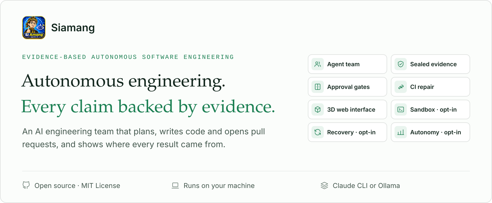
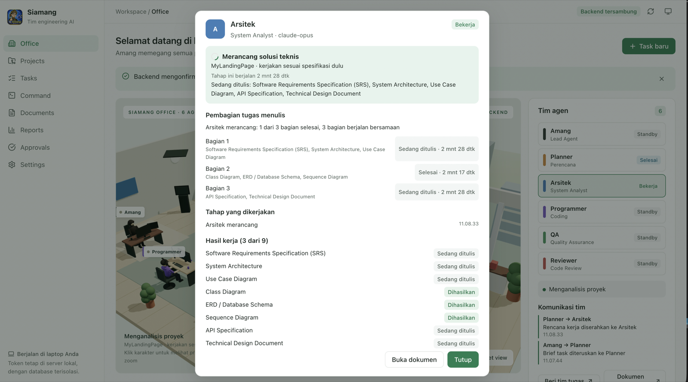
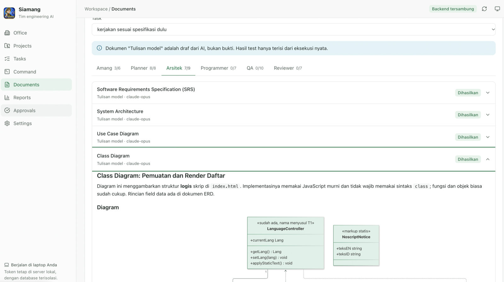
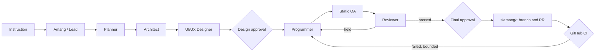
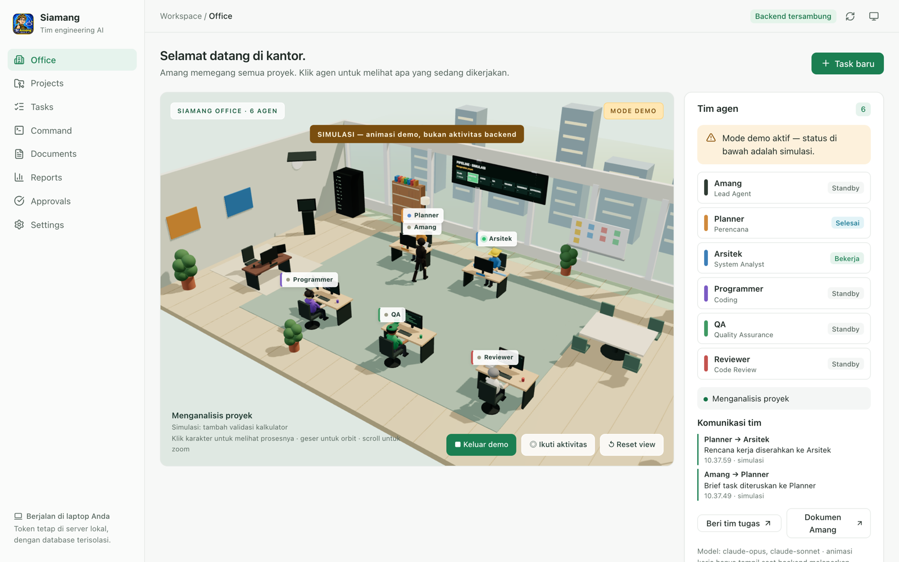

<p align="center">
  <picture>
    <source media="(prefers-color-scheme: dark)" srcset="./docs/images/readme/hero-en-dark.svg">
    
  </picture>
</p>

<p align="center">
  <a href="./docs/README.md"></a>
  <a href="./CHANGELOG.md"></a>
  <a href="./LICENSE"></a>
  <a href="./pyproject.toml"></a>
  <a href="https://github.com/Rafie93/siamang-ai/stargazers"></a>
  <br/>
  <a href="https://github.com/Rafie93/siamang-ai/actions/workflows/ci.yml"></a>
  <a href="#web-interface"></a>
  <a href="https://code.claude.com/docs"></a>
  <a href="https://ollama.com/"></a>
</p>

<p align="center">
  <b>English</b> · <a href="./README_ID.md">Bahasa Indonesia</a>
</p>

<p align="center">
  <a href="#overview">Overview</a> ·
  <a href="#demo">Demo</a> ·
  <a href="#quick-start">Quick Start</a> ·
  <a href="#web-interface">Web Interface</a> ·
  <a href="#cli">CLI</a> ·
  <a href="#http-api">HTTP API</a> ·
  <a href="#whats-new">What's New</a> ·
  <a href="#features">Features</a> ·
  <a href="#documentation">Documentation</a> ·
  <a href="#development">Development</a>
</p>

## Overview

Siamang is an AI engineering team that takes a software task, plans it, writes code for a real repository, checks it, and opens a pull request once you agree. You are not asked to trust what an agent says, because every result shows where it came from.

It stands alone: no external control plane, and the core uses nothing beyond the Python standard library.

> [!IMPORTANT]
> **v0.3.0 is early.** Siamang runs locally for one operator and is not ready for the internet. Full autonomy is still in progress. In the default configuration two gates need your approval and Siamang does not run project code, so test results come only from GitHub CI. See [Features](#features).

## Demo

These screenshots come from a real run: a task on a small landing page project, with `claude-opus` as the model. The interface text is in Indonesian.

### How it works: the team divides the work

<a href="./docs/images/readme/cara-kerja-membagi-part.png">
  
</a>

Instead of one long model call, the Architect's design documents are split into parts that run at the same time. Click any agent to see what it is doing now: which documents each part is writing, how long it has been running, and what is finished. The line "3 parts running at the same time" is computed from the times the backend records, not assumed.

### The result: documents you can read

<a href="./docs/images/readme/bukti-nyata-kerja.png">
  
</a>

Each agent's output has its own tab, and diagrams are drawn on the page. Every document says where it came from: here, *Tulisan model · claude-opus* means it was written by a model. These are drafts, not evidence, and the page says so. Programmer, QA and Reviewer still show 0 because coding starts only after you approve the design.

## Why Siamang

Coding agents often report "all tests pass". In Siamang, a model cannot make that claim.

| Principle | Today | Planned |
|---|---|---|
| **Every result shows its origin** | Documents are labelled `authored` (written by a model), `derived` (computed by the system) or `measured` (a real measurement) | Also for every agent action |
| **A model cannot claim a pass** | Pass status comes from deterministic checks, and test results from CI, or from the sandbox when it is on | Each acceptance criterion matched to a check |
| **Decisions are bound to evidence** | Approval recomputes the evidence chain and refuses anything that changed | Automatic decisions recorded the same way |
| **Failure means repair, within limits** | A failed design stage retries up to three rounds, a timed-out package splits in two, and failed CI returns to the Programmer; all bounded and recorded | Replanning that really changes the steps |
| **Autonomy can be audited** | Two gates need a human by default; risk-based gates can be turned on, and their decisions are recorded in the policy's name | Levels per project |

### How a task runs



## Quick Start

**You need:** macOS or Linux, Python 3.11+ and Git 2.36+. The web interface also needs Node.js 20.19+. To work on GitHub repositories, log in with [`gh`](https://cli.github.com/) using an account that can write to them.

### 1. Install

```bash
git clone https://github.com/Rafie93/siamang-ai.git
cd siamang-ai
python3 -m venv .venv
source .venv/bin/activate
pip install -e '.[api]'
```

### 2. Choose a model

Copy one template to `siamang.toml`, which stays out of Git:

| Model | Command | Before you start |
|---|---|---|
| Claude | `cp siamang.claude.example.toml siamang.toml` | Log in with the [`claude`](https://code.claude.com/docs) CLI. For personal use. |
| Ollama | `cp siamang.ollama.example.toml siamang.toml` | Run [Ollama](https://ollama.com/), and set `provider_model` to a tag from `ollama list`. |

Then check it:

```bash
export SIAMANG_CONFIG="$PWD/siamang.toml"
siamang health            # configuration, storage and database
siamang models --check    # exits with an error if the model provider is not ready
```

### 3. Choose how to work

| Way | Good for | Runs the agents? |
|---|---|---|
| [Web interface](#web-interface) | Everyday use: start here | Yes |
| [HTTP API](#http-api) | Scripts and integrations | Yes |
| [CLI](#cli) | Inspecting and managing what is stored | No |

## Web Interface

```bash
cd web
npm install
npm run dev               # http://127.0.0.1:5180
```

This one command also starts the backend, so you don't need to start the API server. Stop everything with `Ctrl+C`. For a production build, run `npm run build && npm start` instead.

<a href="./docs/images/readme/office-light.png">
<picture>
  <source media="(prefers-color-scheme: dark)" srcset="./docs/images/readme/office-dark.png">
  
</picture>
</a>

<p align="center"><sub>Demo mode, which is always labelled as a simulation.</sub></p>

### Your first task

The interface text is currently in Indonesian, so the button names below are shown as they appear.

1. Check that the top bar says **Backend tersambung** (backend connected).
2. Open **Projects**, choose **Proyek baru** (new project), paste a GitHub URL such as `https://github.com/OWNER/REPO`, and choose **Buat proyek** (create project).
3. Amang reads the repository and asks questions. Answer them on the project page, then choose **Setujui spesifikasi** (approve the specification).
4. Open **Command**, write what you want, and choose **Kirim ke Amang** (send to Amang). Check the summary, then choose **Setuju, buat task dan mulai** (agree, create the task and start).
5. Follow the work in **Office** or **Tasks**. When the design is ready, read it in **Documents** and choose **Setujui desain** (approve the design) on the task.
6. When the result is ready, read the evidence in **Reports**, then choose **Approve** in **Approvals**. Siamang creates a commit on a `siamang/*` branch and opens a pull request. Merging stays with you.

To look around without a model or a repository, choose **▶ Mode demo** on the **Office** page. To change which model each agent uses, open **Settings**.

### What's in it

| Area | What it does |
|---|---|
| **3D office** | Seven agents, each with a desk and an animated monitor. Orbit, zoom, follow the activity, or click an agent to see its work. |
| **Handoffs** | Each recorded phase change plays as a handoff between agents. An agent is shown working only when the backend reports fresh activity, never when offline or stale. |
| **Two-way command** | Amang checks your instruction before a task exists, and a stopped task explains why and can continue with your answer. |
| **Documents** | Each agent's output with its origin: written by a model, computed by the system, or measured. |
| **Evidence and approvals** | Checks with exit codes, recovery attempts and technical debt when the sandbox is on. Without it, the page says the code was not run. |
| **Demo mode** | A simulated run for presentations, always labelled and kept out of Tasks, Reports and Approvals. |
| **Accessibility** | A text team list and log, reduced motion, native keyboard-friendly controls, and a 2D fallback without WebGL. |

### Settings

| Variable | Default | Purpose |
|---|---|---|
| `PORT` | `5180` | Port of the interface |
| `WEB_DATA` | `~/.siamang/web` | Its database, seal key and project clones. Keep it outside this repository. |
| `SIAMANG_ROOT` | the parent folder | Where the backend is |
| `WEB_SANDBOX` | off | `1` adds a sample project, which the end-to-end tests need |

## CLI

The CLI inspects and manages what Siamang has stored. **It does not run the agents:** to start work, use the web interface or the HTTP API. It reads the configuration from `SIAMANG_CONFIG` or `--config`, so run this first in each new terminal:

```bash
source .venv/bin/activate
export SIAMANG_CONFIG="$PWD/siamang.toml"
```

| Command | What it does |
|---|---|
| `siamang health`, `siamang version` | Check configuration, storage and database; show versions |
| `siamang validate` | Validate configuration, database schema and contract |
| `siamang models --check` | List models and check that their provider is ready |
| `siamang projects` | List projects; add `--all` for archived ones and `--json` for scripts |
| `siamang projects register --name NAME --path PATH --type web` | Register a local repository |
| `siamang projects get\|update\|archive\|restore` | Manage a project |
| `siamang git inspect\|status\|diff\|worktrees PROJECT_ID` | Read-only Git views of a project |
| `siamang tasks --project PROJECT_ID` | List tasks; filter with `--status` |
| `siamang tasks get TASK_ID` | Read one task |
| `siamang tasks cancel\|retry TASK_ID --yes` | Cancel a task or queue it again; nothing is executed |
| `siamang tasks recovery` | List active tasks, to see what may need recovery |
| `siamang replay TASK_ID`, `siamang events` | Read stored events |
| `siamang tools`, `siamang orchestrator`, `siamang planner`, `siamang qa`, `siamang approval`, ... | Show catalogs and policies; nothing is executed |

Run `siamang --help` for everything, or `siamang COMMAND --help` for one command.

> [!NOTE]
> The web interface keeps its own database, separate from the one in `siamang.toml`. To read its projects and tasks from the CLI, point the CLI at it. This works while the interface is running:
>
> ```bash
> SIAMANG_STORAGE_PATH="$HOME/.siamang/web/office.db" siamang projects
> ```

## HTTP API

Use this for scripts. Unlike the web interface, you start the server yourself, and it needs local credentials. It binds to `127.0.0.1` only.

```bash
python3 scripts/init-credentials.py    # creates ~/.config/siamang/local.env and prints SIAMANG_TOKEN once: keep it
./scripts/run-local.sh --port 8765
```

In another terminal, run the `export SIAMANG_TOKEN=...` line printed above, then:

```bash
api() { curl -s -H "Authorization: Bearer $SIAMANG_TOKEN" -H 'Content-Type: application/json' "http://127.0.0.1:8765/v0$1" "${@:2}"; }

api /capabilities    # confirms the server and model are ready
api /projects -d '{"name": "demo", "repository": "OWNER/REPO"}'    # Siamang clones it into its own directory
```

A task then moves through these calls:

| # | Step | API call |
|---|---|---|
| 1 | Amang reads the repository and asks; answer, then approve the specification | `POST /projects/{id}/intake/messages`, `POST /projects/{id}/intake/approve` |
| 2 | Describe the work; Amang writes a brief and you confirm it | `POST /projects/{id}/drafts`, `POST /projects/{id}/drafts/{draft}/confirm` |
| 3 | Planner, Architect, and Designer write design documents; the run stops at the first gate | `GET /tasks/{id}/documents`, `POST /tasks/{id}/design-decision` |
| 4 | Programmer, QA and Reviewer work in a bounded loop; the run stops at the second gate | `GET /tasks/{id}/reports`, `GET /approvals?project_id={id}` |
| 5 | Once you agree, Siamang recomputes the evidence and creates the commit and PR | `POST /approvals/{run_id}` |
| 6 | Siamang follows CI; a failure returns to the Programmer, within limits | `GET /tasks/{id}` (`task.ci`) |

Both decisions use the same body. In the default configuration, merging stays with you.

```bash
api /tasks/TASK_ID/design-decision -d '{"decision": "approve", "reason": "The design fits."}'
api /approvals/RUN_ID -d '{"decision": "approve", "reason": "I checked the evidence."}'
```

The full reference is in [docs/HTTP_API.md](docs/HTTP_API.md), and the OpenAPI contract is at `GET /v0/openapi.json`.

## What's New

### v0.3.0

Not tagged as a GitHub release yet. Details are in the [changelog](./CHANGELOG.md).

- **Sandbox execution** (opt-in): tests and builds run in a container, and that result decides whether a run passes. Not yet tested with a real container.
- **Programmer tools** (opt-in): the Programmer edits and runs commands inside the sandbox before proposing a patch.
- **Recovery Engine** (opt-in): three tiers of bounded recovery when delivery fails. Not yet applied to parallel-package runs.
- **Autonomy levels and autonomous Lead** (opt-in): risk-based gates, recorded in the policy's name. Not yet tested with a real model, container and GitHub together.
- **Work division**: design documents and work packages run in parallel within a task, with bounded retries, and the record shows what really ran at the same time.
- **Automatic CI repair**: a failed build on an approved, open pull request returns to the Programmer, a limited number of times.
- **Web interface in one repository**: rebuilt without a commercial template, and now lives in `web/` with the same version as the backend.

## Features

| Capability | Status | Notes |
|---|---|---|
| Lead, Planner, Architect, Designer, Programmer, QA, Reviewer | Available | Stage order is decided by code |
| `siamang/*` branches, PRs and reading GitHub CI | Available | No force push; no merge except at autonomy level 3 |
| Automatic repair when CI fails | Available | Only on an approved, open PR; `ci_repair = 0` turns it off |
| Parallel work packages | Available | So far tested only with a fake model |
| Tests and builds in a sandbox | Opt-in, off by default | Not yet tested with a real container |
| Programmer with tools | Opt-in, off by default | Not yet tested with a real container |
| Three-tier Recovery Engine | Opt-in, off by default | Not yet applied to parallel-package runs |
| Autonomy levels and autonomous Lead | Opt-in, off by default | Not yet tested with a real model, container and GitHub; [docs/AUTONOMY.md](docs/AUTONOMY.md) |
| Matching acceptance criteria to checks | Not yet | Today every criterion is `not_verified` |
| Several tasks at once | Not yet | One task runs at a time |
| Multi-user login, TLS, GitHub App | Not yet | Do not expose the API to the internet |

**Benchmarks:** no publishable results exist yet, so this README states no figures for quality, cost or time. The plan is in [Phase 32.5](docs/PHASE_ROADMAP.md#phase-325-benchmark-kesiapan-rilis). The tests here run offline with a fake model: they prove how the system behaves, not the quality of the code a model writes.

## Security and Limits

- Pushes go only to `siamang/*` branches, without force. A merge happens only if the operator chooses autonomy level 3.
- In the default configuration the first change always waits for your approval. Automatic CI repair only enters a PR you approved that is still open.
- A CI repair is held if it appears to hide the failure, for example by changing CI configuration, deleting tests or adding skips. This check is a heuristic, not proof of an honest repair.
- Agents read repository content and send it to the model provider you choose.
- Siamang pushes to GitHub with your `gh` login.
- A pass from static QA does not prove the code runs. Review every PR before merging.

Read [SECURITY.md](SECURITY.md) before running Siamang. Report vulnerabilities through the repository's **Security** tab, not in a public issue.

## Documentation

Documents under `docs/` are currently written mostly in Indonesian.

| Document | Contents |
|---|---|
| [docs/README.md](docs/README.md) | Index of all documentation |
| [docs/REFERENCE.md](docs/REFERENCE.md) | Configuration, CLI, HTTP API summary, the agent team and large-task behavior |
| [docs/VISION.md](docs/VISION.md) | Goals, principles, autonomy levels, component status |
| [docs/PHASE_ROADMAP.md](docs/PHASE_ROADMAP.md) | Order of work |
| [docs/ARCHITECTURE.md](docs/ARCHITECTURE.md) | Structure and design decisions |
| [docs/HTTP_API.md](docs/HTTP_API.md) | API reference |
| [docs/SANDBOX.md](docs/SANDBOX.md) | Tests and builds in a container (opt-in) |
| [docs/AUTONOMY.md](docs/AUTONOMY.md) | Autonomy levels and autonomous Lead (opt-in) |
| [docs/SKILL.md](docs/SKILL.md) | Guide for AI agents |
| [docs/WEB.md](docs/WEB.md) | Web interface: layers, data flow and the rules of the 3D scene |
| [docs/WEB_CONTRACT.md](docs/WEB_CONTRACT.md) | The HTTP contract the web interface uses |
| [THIRD_PARTY_NOTICES.md](THIRD_PARTY_NOTICES.md) | Dependencies and their licenses |

## Development

```bash
pip install -e '.[dev,api]'
.venv/bin/pytest                               # offline tests, no LLM
.venv/bin/python scripts/smoke_http.py         # HTTP against a temporary server and database
cd web && npm ci && npm test                             # web unit and component tests
```

See [CONTRIBUTING.md](./CONTRIBUTING.md). Maintained by one person, so please open an issue before a large change.

## License

[MIT](./LICENSE)
