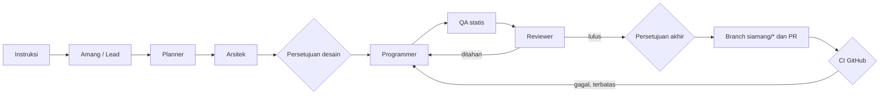

<div align="center">

# Siamang

### Evidence-Based Autonomous Software Engineering

**Autonomous engineering. Every claim backed by evidence.**

*Rekayasa software otonom. Setiap klaim ada buktinya.*

[](https://github.com/Rafie93/siamang-ai/actions/workflows/ci.yml)
[](#status-hari-ini)
[](pyproject.toml)
[](LICENSE)

Instruksi → tim agen AI → pull request yang disertai bukti.

[Mengapa Siamang](#mengapa-siamang) •
[Status](#status-hari-ini) •
[Quick start](#quick-start) •
[Satu task dari awal sampai PR](#satu-task-dari-awal-sampai-pr) •
[Referensi](#referensi) •
[Dokumentasi](#dokumentasi)

</div>

Siamang adalah tim engineering AI yang menerima tugas pengembangan software, merencanakannya, menulis kode untuk repo
nyata, memeriksanya, lalu membuka pull request setelah Anda setuju. Anda tidak diminta percaya pada jawaban agen, karena
setiap hasil menunjukkan dari mana asalnya.

Siamang berdiri sendiri: tanpa control plane eksternal, dan intinya tanpa dependency Python di luar standard library.

> [!IMPORTANT]
> **v0.3.0 masih tahap awal.** Siamang berjalan lokal untuk satu operator dan belum siap dipasang di internet. Otonomi
> penuh masih dalam pengerjaan. Pada konfigurasi bawaan, dua gerbang wajib disetujui manusia dan Siamang tidak
> menjalankan kode proyek, sehingga hasil test hanya berasal dari CI GitHub. Lihat [Status hari ini](#status-hari-ini).

## Mengapa Siamang

Agen coding sering melaporkan "semua test lulus". Di Siamang, model tidak bisa membuat klaim itu.

| Prinsip | Hari ini | Direncanakan |
|---|---|---|
| **Asal setiap hasil terlihat** | Dokumen berlabel `authored` (tulisan model), `derived` (dihitung sistem), atau `measured` (hasil ukur) | Berlaku juga untuk tiap aksi agen |
| **Model tidak bisa mengaku lulus** | Status lulus berasal dari pemeriksaan deterministik, dan hasil test dari CI, atau dari sandbox bila dinyalakan | Setiap acceptance criteria dicocokkan dengan sebuah check |
| **Keputusan terikat pada bukti** | Persetujuan menghitung ulang rantai bukti dan menolak yang berubah | Keputusan otomatis dicatat dengan cara yang sama |
| **Gagal berarti diperbaiki, dengan batas** | Tahap desain yang gagal diulang tiga putaran, paket yang timeout dibelah dua, CI yang gagal kembali ke Programmer; semuanya berbatas dan tercatat | Perencanaan ulang yang benar-benar mengubah langkah |
| **Otonomi bisa diaudit** | Pada konfigurasi bawaan dua gerbang wajib disetujui manusia; gerbang berbasis risiko bisa dinyalakan, dan keputusannya tercatat atas nama kebijakan | Level per proyek |

## Status hari ini

| Kemampuan | Status | Catatan |
|---|---|---|
| Lead, Planner, Arsitek, Programmer, QA, Reviewer | Tersedia | Alur tahap ditentukan kode |
| Branch `siamang/*`, PR, dan pembacaan CI GitHub | Tersedia | Tanpa force push; tanpa merge kecuali level otonomi 3 |
| Perbaikan otomatis saat CI gagal | Tersedia | Hanya pada PR yang sudah disetujui dan masih terbuka; `ci_repair = 0` untuk mematikan |
| Paket kerja paralel | Tersedia | Sejauh ini baru diuji dengan model tiruan |
| Test dan build di sandbox | Opsional, mati secara bawaan | Belum diuji dengan container nyata |
| Programmer yang memakai tool | Opsional, mati secara bawaan | Belum diuji dengan container nyata |
| Recovery Engine tiga tingkat | Opsional, mati secara bawaan | Belum berlaku untuk run paket paralel |
| Level otonomi dan Lead otonom | Opsional, mati secara bawaan | Belum diuji dengan model, container, dan GitHub nyata; [docs/AUTONOMY.md](docs/AUTONOMY.md) |
| Pencocokan acceptance criteria dengan check | Belum ada | Hari ini semua kriteria berstatus `not_verified` |
| Beberapa task bersamaan | Belum ada | Satu task berjalan pada satu waktu |
| Login multi-user, TLS, GitHub App | Belum ada | Jangan buka API ke internet |

**Benchmark:** belum ada hasil yang bisa diterbitkan, jadi README ini tidak memuat angka kualitas, biaya, atau waktu.
Rencana benchmark ada di [Phase 32.5](docs/PHASE_ROADMAP.md#phase-325-benchmark-kesiapan-rilis). Test di repo ini berjalan
offline dengan model tiruan: test membuktikan perilaku sistem, bukan mutu kode yang ditulis model.

## Quick start

**Yang dibutuhkan:**

- macOS atau Linux
- Python 3.11+ dan Git 2.36+
- [`gh`](https://cli.github.com/) yang sudah login, dengan akses tulis ke repo target
- Model: [`claude`](https://code.claude.com/docs) CLI yang sudah login, atau [Ollama](https://ollama.com/)

### 1. Pasang

```bash
git clone https://github.com/Rafie93/siamang-ai.git
cd siamang-ai
python3 -m venv .venv
.venv/bin/pip install -e '.[dev,api]'
```

### 2. Pilih model

Buat `siamang.toml`. Tiap agen bisa memakai model yang berbeda:

```bash
cat > siamang.toml <<'EOF'
[storage]
path = "data/siamang.db"

[providers.claude]
type = "claude_cli"           # memakai login CLI `claude` Anda, untuk pemakaian pribadi
timeout_secs = 600

[models.claude-sonnet]
provider = "claude"
provider_model = "sonnet"
capabilities = ["text_generation", "structured_output"]
priority = 10

[agents.lead]
model = "claude-sonnet"

[agents.planner]
model = "claude-sonnet"

[agents.analyst]
model = "claude-sonnet"

[agents.programmer]
model = "claude-sonnet"

[agents.qa]
model = "claude-sonnet"

[agents.reviewer]
model = "claude-sonnet"
EOF

.venv/bin/siamang --config siamang.toml health
```

### 3. Buat kredensial lokal

Perintah ini membuat `~/.config/siamang/local.env` sekali saja dan menolak menimpa file yang sudah ada, karena mengganti
kunci segel membuat bukti lama tidak bisa dipakai. Simpan token yang tercetak; server hanya menyimpan hash-nya.

```bash
mkdir -p ~/.config/siamang
.venv/bin/python - <<'EOF'
import hashlib, json, os, secrets, shlex

token = secrets.token_urlsafe(48)
identities = {"owner": {
    "token_sha256": hashlib.sha256(token.encode()).hexdigest(),
    "permissions": ["read", "submit", "run", "cancel", "retry", "approve", "configure"],
    "projects": ["*"],
}}
path = os.path.expanduser("~/.config/siamang/local.env")
with os.fdopen(os.open(path, os.O_WRONLY | os.O_CREAT | os.O_EXCL, 0o600), "w") as env:
    env.write(f"export SIAMANG_API_IDENTITIES={shlex.quote(json.dumps(identities))}\n")
    env.write(f"export SIAMANG_API_SEAL_KEY={secrets.token_hex(32)}\n")
print(f"export SIAMANG_TOKEN={token}")
EOF
```

### 4. Jalankan server

```bash
./scripts/run-local.sh --port 8765
```

Server hanya bind ke `127.0.0.1` dengan satu worker. Tanpa kredensial, server menolak berjalan.

### 5. Kirim task pertama

Di terminal lain, jalankan baris `export SIAMANG_TOKEN=...` yang tercetak di langkah 3, lalu:

```bash
api() { curl -s -H "Authorization: Bearer $SIAMANG_TOKEN" -H 'Content-Type: application/json' "http://127.0.0.1:8765/v0$1" "${@:2}"; }

api /capabilities                  # memastikan server dan model siap

# Daftarkan repo. Siamang meng-clone-nya ke direktori miliknya sendiri.
api /projects -d '{"name": "demo", "repository": "OWNER/REPO"}'
```

Lanjutkan dengan [satu task dari awal sampai PR](#satu-task-dari-awal-sampai-pr).

> [!NOTE]
> Antarmuka visualnya, Virtual Office, adalah proyek terpisah yang belum dirilis. Sampai saat itu, Siamang dipakai lewat
> HTTP API dan CLI.

## Satu task dari awal sampai PR



| # | Langkah | Panggilan API |
|---|---|---|
| 1 | Amang membaca repo dan bertanya; jawab lalu setujui spesifikasinya | `POST /projects/{id}/intake/messages`, `POST /projects/{id}/intake/approve` |
| 2 | Sampaikan pekerjaan; Amang menyusun brief, lalu Anda mengonfirmasinya | `POST /projects/{id}/drafts`, `POST /projects/{id}/drafts/{draft}/confirm` |
| 3 | Planner dan Arsitek menulis dokumen desain; run berhenti di gerbang pertama | `GET /tasks/{id}/documents`, `POST /tasks/{id}/design-decision` |
| 4 | Programmer, QA, dan Reviewer bekerja dalam loop terbatas; run berhenti di gerbang kedua | `GET /tasks/{id}/reports`, `GET /approvals?project_id={id}` |
| 5 | Setelah Anda setuju, Siamang menghitung ulang bukti, membuat commit dan PR | `POST /approvals/{run_id}` |
| 6 | Siamang mengikuti CI; yang gagal kembali ke Programmer, dengan batas | `GET /tasks/{id}` (`task.ci`) |

Pada konfigurasi bawaan, merge tetap di tangan Anda. Kedua keputusan memakai body yang sama:

```bash
api /tasks/TASK_ID/design-decision -d '{"decision": "approve", "reason": "Desain sesuai kebutuhan."}'
api /approvals/RUN_ID -d '{"decision": "approve", "reason": "Bukti sudah saya periksa."}'
```

### Tim agen

| Agen | Tugas | Memakai model |
|---|---|---|
| **Amang (Lead)** | Bertanya, menyusun brief, melapor | Ya |
| **Planner** | PRD, roadmap, WBS, acceptance criteria | Ya |
| **Arsitek** | SRS, arsitektur, diagram, pembagian paket kerja per gelombang | Ya |
| **Programmer** | Menulis patch per paket, dengan beberapa paket sekaligus dalam satu gelombang | Ya |
| **QA** | Pemeriksaan statis yang menentukan; model hanya menulis rencana test | Sebagian |
| **Reviewer** | Pemeriksaan deterministik yang menentukan; ulasan model bersifat saran | Sebagian |

Di konfigurasi, Arsitek bernama `analyst`.

### Bukti yang bisa Anda periksa

| Sumber | Ditulis oleh | Aturan |
|---|---|---|
| `authored` | Model | Draf atau pendapat, tidak pernah dianggap bukti |
| `derived` | Kode | Termasuk putusan QA dan Reviewer; model tidak bisa mengubahnya |
| `measured` | Eksekusi nyata | Model tidak ditanya; tetap `not_run` sampai hasil ukurnya ada |

Bukti dan keputusan disegel dengan HMAC. Saat Anda menyetujui, server memuat artefak miliknya sendiri, menghitung ulang
rantai bukti, dan menolak yang berubah. Klien tidak bisa mengirim patch, status lulus, atau segel.

## Pekerjaan besar

Satu panggilan model tidak cukup untuk pekerjaan besar seperti upgrade framework. Siamang memecahnya, dan mencatat apa
yang benar-benar terjadi.

| Kondisi | Yang dilakukan Siamang | Bukti yang bisa dilihat |
|---|---|---|
| Satu tahap desain punya banyak dokumen | Maksimal 3 dokumen per panggilan, 3 panggilan bersamaan | `design_parts`: dokumen, jam mulai dan selesai, status tiap panggilan |
| Panggilan desain gagal | Hanya bagian yang gagal diulang, sampai 3 putaran dengan waktu 300, 450, lalu 600 detik | Event riwayat membawa `attempt`, `retry_reason`, `remaining` |
| Task gagal lalu diantrekan ulang | Dokumen yang sudah jadi dipakai ulang, selama instruksi, spesifikasi, dan jawaban Anda sama | Event riwayat membawa `reused` |
| Pekerjaan menyentuh banyak file | Arsitek membaginya menjadi paket per gelombang: satu gelombang paralel, gelombang berikutnya melihat hasilnya | `work_packages` dan `task.packages` dengan `wave` |
| Paket timeout | Dicoba sekali lagi, lalu dibelah dua menurut path miliknya | `attempt` pada paket, dan judul "(a)" dan "(b)" |
| Pembagian kerja gagal | Model ditanya sekali lagi beserta alasannya; bila tetap gagal, statusnya `failed`, tidak pernah dilaporkan sebagai "cukup satu Programmer" | Dokumen `work_packages`, dan "bagi ulang" di gerbang desain |

Paket yang digabung dijaga dengan aturan path yang diperiksa kode, kontrak bersama yang diterima setiap paket, dan satu
putaran QA serta Reviewer atas hasil gabungan. Jalur paket sejauh ini baru diuji dengan model tiruan; batasnya ada di
[docs/PHASE_ROADMAP.md](docs/PHASE_ROADMAP.md).

## Keamanan dan batasan

Batasan yang sengaja dijaga:

- Push hanya ke branch `siamang/*`, tanpa force. Merge hanya terjadi bila operator memilih level otonomi 3.
- Pada konfigurasi bawaan, perubahan pertama selalu menunggu persetujuan Anda. Perbaikan CI otomatis hanya masuk ke PR yang sudah Anda setujui dan masih terbuka.
- Perbaikan CI ditahan bila terlihat menyembunyikan kegagalan, misalnya mengubah konfigurasi CI, menghapus test, atau menambah skip. Pemeriksaan ini heuristik, bukan bukti perbaikan yang jujur.
- Dokumen tulisan model diberi label draf, dan hasil test tidak pernah ditulis model.
- Satu task berjalan pada satu waktu. Paralel hanya terjadi di dalam satu task: antar-bagian dokumen desain dan antar-paket satu gelombang.

Yang perlu Anda ketahui sebelum memakainya:

- Agen membaca isi repo dan mengirimkannya ke provider model yang Anda pilih.
- Siamang push ke GitHub memakai login `gh` Anda.
- Status lulus dari QA statis tidak membuktikan kode berjalan. Tinjau setiap PR sebelum merge.

Baca [SECURITY.md](SECURITY.md) sebelum menjalankan Siamang. Kerentanan dilaporkan lewat tab **Security** di repo, bukan
lewat issue publik.

## Referensi

<details>
<summary><strong>Konfigurasi</strong></summary>

Config dibaca dari `--config FILE` atau `SIAMANG_CONFIG`, dan bisa ditimpa per key dengan `SIAMANG_<SECTION>_<KEY>`.
Contoh lengkapnya ada di [siamang.example.toml](siamang.example.toml). Database bawaan ada di `~/.siamang/siamang.db`.

```toml
[providers.claude]
type = "claude_cli"
timeout_secs = 600            # tanpa ini satu panggilan dibatasi 120 detik; 600 adalah batas atasnya

[agents.programmer]
model = "claude-sonnet"
parallel = 3                  # paket kerja bersamaan per gelombang (1-6)
ci_repair = 2                 # berapa kali CI gagal kembali ke Programmer (0-3, 0 = mati)
```

Waktu satu panggilan adalah yang terkecil dari batas tahapnya, `timeout_secs` provider, dan 600 detik. Nilai di bawah 600
membuat percobaan ulang tahap desain tidak mendapat waktu lebih.

| Provider | Untuk |
|---|---|
| `claude_cli` | Login CLI `claude` Anda, untuk pemakaian pribadi |
| `ollama` | Model lokal; pilih model yang sudah terpasang |
| `echo` | Hanya untuk menguji sambungan; ditolak oleh HTTP API |

Jika model belum dikonfigurasi, run ditolak, bukan berpura-pura bekerja.

Sandbox dan Recovery Engine mati secara bawaan. Cara menyalakannya ada di [docs/SANDBOX.md](docs/SANDBOX.md) dan
`siamang.example.toml`.

</details>

<details>
<summary><strong>HTTP API</strong></summary>

Semua route `/v0` butuh bearer token dan izin yang sesuai. Referensi lengkap ada di [docs/HTTP_API.md](docs/HTTP_API.md),
dan kontrak OpenAPI ada di `GET /v0/openapi.json`.

| Method | Route | Fungsi |
|---|---|---|
| GET | `/v0/health`, `/v0/capabilities` | Kesehatan server, model, dan kemampuan yang aktif |
| POST | `/v0/projects` | Mendaftarkan dan meng-clone repo GitHub |
| POST | `/v0/projects/{id}/intake/messages`, `.../intake/approve` | Spesifikasi proyek bersama Lead |
| POST | `/v0/projects/{id}/drafts`, `.../drafts/{draft}/confirm` | Percakapan sebelum task, lalu memulai task |
| GET | `/v0/tasks/{id}`, `.../documents`, `.../reports`, `.../execution-events` | Status, dokumen agen, laporan, dan riwayat |
| POST | `/v0/tasks/{id}/design-decision` | Gerbang desain |
| GET, POST | `/v0/approvals`, `/v0/approvals/{run_id}` | Gerbang akhir |
| POST | `/v0/tasks/{id}/messages`, `.../retry`, `.../cancel`, `.../publish` | Melanjutkan, mengulang, membatalkan, menerbitkan ulang |

</details>

<details>
<summary><strong>CLI</strong></summary>

CLI untuk inspeksi dan pengelolaan. Pekerjaan agen dijalankan lewat HTTP API.

```bash
siamang health | validate [pesan.json]         # kesehatan dan validasi kontrak
siamang models --check                         # provider dan model
siamang projects register --name NAMA --path PATH --type web
siamang projects [--all] [--json]              # juga: get, update, archive, restore
siamang git inspect|status|diff|worktrees PRJ  # Git read-only
siamang tasks [--project PRJ] [--status S]     # juga: get, recovery, cancel, retry
siamang replay TSK                             # replay event task
siamang tools | agents                         # katalog
siamang orchestrator | planner | analyst | programmer | qa | reviewer | loop | approval
                                               # menampilkan kebijakan, tidak menjalankan apa pun
```

</details>

<details>
<summary><strong>Menguji Siamang sendiri</strong></summary>

```bash
.venv/bin/pytest                               # test offline, tanpa LLM
.venv/bin/python scripts/smoke_http.py         # HTTP dengan server dan database sementara
```

</details>

## Dokumentasi

| Dokumen | Isi |
|---|---|
| [docs/README.md](docs/README.md) | Index seluruh dokumentasi |
| [docs/VISION.md](docs/VISION.md) | Tujuan, prinsip, level otonomi, status komponen |
| [docs/PHASE_ROADMAP.md](docs/PHASE_ROADMAP.md) | Urutan pekerjaan |
| [docs/ARCHITECTURE.md](docs/ARCHITECTURE.md) | Struktur dan keputusan desain |
| [docs/HTTP_API.md](docs/HTTP_API.md) | Referensi API |
| [docs/SANDBOX.md](docs/SANDBOX.md) | Test dan build di container, opsional |
| [docs/AUTONOMY.md](docs/AUTONOMY.md) | Level otonomi dan Lead otonom, opsional |
| [docs/SKILL.md](docs/SKILL.md) | Panduan untuk agen AI |

## Lisensi

[MIT](LICENSE)
