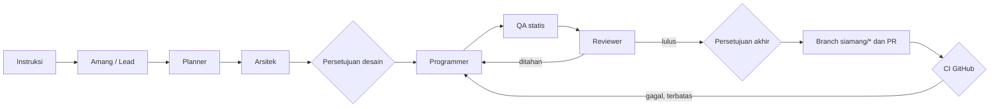

# Siamang

**Evidence-Based Autonomous Software Engineering**

*Autonomous engineering. Every claim backed by evidence.*

*Rekayasa software otonom. Setiap klaim ada buktinya.*

Siamang adalah tim engineering AI yang menerima tugas pengembangan software,
merencanakannya, menulis kode untuk repo nyata, memeriksanya, lalu membuka pull
request setelah Anda setuju. Bedanya: Anda tidak diminta percaya pada jawaban
agen, karena setiap hasil menunjukkan dari mana asalnya.

> **Status:** v0.3.0, berjalan lokal untuk satu operator, dan belum siap dipasang di
> internet. Otonomi penuh masih dalam pengerjaan. Pada konfigurasi bawaan, QA statis dan
> hasil test hanya berasal dari CI GitHub. Test dan build di sandbox, Programmer yang
> memakai tool, dan Recovery Engine sudah ada sebagai opsi yang mati secara bawaan, dan
> belum diuji dengan container nyata. Lihat [docs/VISION.md](docs/VISION.md).

## Apa arti Evidence-Based

| Prinsip | Hari ini | Direncanakan |
|---|---|---|
| **Asal setiap hasil terlihat** | Dokumen berlabel `authored` (tulisan model), `derived` (dihitung sistem), atau `measured` (hasil ukur) | Berlaku juga untuk tiap aksi agen |
| **Model tidak bisa mengaku lulus** | Status lulus berasal dari pemeriksaan deterministik, dan hasil test dari CI, atau dari sandbox bila dinyalakan | Setiap acceptance criteria dicocokkan dengan sebuah check |
| **Keputusan terikat pada bukti** | Persetujuan menghitung ulang rantai bukti dan menolak yang berubah | Keputusan otomatis dicatat dengan cara yang sama |
| **Gagal berarti diperbaiki, dengan batas** | Tahap desain yang gagal diulang tiga putaran, paket yang timeout dibelah dua, CI yang gagal kembali ke Programmer; semuanya berbatas dan tercatat; agen dilarang melemahkan test | Perencanaan ulang yang benar-benar mengubah langkah |
| **Otonomi bisa diaudit** | Dua gerbang wajib disetujui manusia; perbaikan CI dicatat atas nama kebijakannya | Gerbang mengikuti kebijakan risiko |

## Cara kerja



| Agen | Tugas | Memakai model |
|---|---|---|
| **Amang (Lead)** | Bertanya, menyusun brief, melapor | Ya |
| **Planner** | PRD, roadmap, WBS, acceptance criteria | Ya |
| **Arsitek** | SRS, arsitektur, diagram, pembagian paket kerja per gelombang | Ya |
| **Programmer** | Menulis patch, per paket, dengan beberapa paket sekaligus dalam satu gelombang | Ya |
| **QA** | Pemeriksaan statis yang menentukan; model hanya menulis rencana test | Sebagian |
| **Reviewer** | Pemeriksaan deterministik yang menentukan; ulasan model bersifat saran | Sebagian |

Batasan yang sengaja dijaga:

* Push hanya ke branch `siamang/*`, tanpa force dan tanpa merge.
* Perubahan pertama selalu menunggu persetujuan Anda. Perbaikan CI otomatis hanya masuk ke PR yang sudah Anda setujui dan masih terbuka, dan merge tetap di tangan Anda.
* Dokumen tulisan model diberi label draf, dan hasil test tidak pernah ditulis model.
* Satu task berjalan pada satu waktu. Paralel hanya terjadi di dalam satu task: antar-bagian dokumen desain dan antar-paket satu gelombang.

## Pekerjaan besar

Satu panggilan model tidak cukup untuk pekerjaan besar seperti upgrade framework. Siamang memecahnya, dan mencatat apa
yang benar-benar terjadi.

| Kondisi | Yang dilakukan Siamang | Bukti yang bisa dilihat |
|---|---|---|
| Satu tahap desain punya banyak dokumen | Maksimal 3 dokumen per panggilan, 3 panggilan bersamaan | `design_parts`: dokumen, jam mulai dan selesai, status tiap panggilan |
| Panggilan desain gagal | Hanya bagian yang gagal diulang, sampai 3 putaran dengan waktu 300, 450, lalu 600 detik | Event riwayat membawa `attempt`, `retry_reason`, `remaining` |
| Task gagal lalu diantrekan ulang | Dokumen yang sudah jadi dipakai ulang, selama instruksi, spesifikasi, dan jawaban Anda sama | Event riwayat membawa `reused` |
| Pekerjaan menyentuh banyak file | Arsitek membaginya menjadi paket per gelombang: satu gelombang paralel, gelombang berikutnya melihat hasilnya | `work_packages` dan `task.packages` dengan `wave` |
| Paket timeout | Dicoba sekali lagi, lalu dibelah dua menurut path miliknya | `attempt` pada paket, dan judul "(a)" dan "(b)" |
| Pembagian kerja gagal | Model ditanya sekali lagi beserta alasannya; bila tetap gagal, statusnya `failed`, tidak pernah dilaporkan sebagai "cukup satu Programmer" | Dokumen `work_packages`, dan "bagi ulang" di gerbang desain |

Paket yang digabung dijaga dengan aturan path yang diperiksa kode, kontrak bersama yang diterima setiap paket, dan satu
putaran QA serta Reviewer atas hasil gabungan. Jalur paket sejauh ini baru diuji dengan model tiruan; batasnya ada di
[docs/PHASE_ROADMAP.md](docs/PHASE_ROADMAP.md).

## Quick start

Butuh Python 3.11 atau lebih baru, serta Git 2.36 atau lebih baru. Proyek GitHub
juga butuh `gh` yang sudah login. Inti Siamang tidak punya dependency Python
eksternal; FastAPI dan Uvicorn hanya untuk HTTP API.

```bash
python3 -m venv .venv
.venv/bin/pip install -e '.[dev,api]'
cp siamang.example.toml siamang.toml      # lalu pilih provider dan model

.venv/bin/siamang health                  # cek config, storage, DB, kontrak
.venv/bin/pytest                          # test offline, tanpa LLM
```

### Menjalankan API

Siapkan `SIAMANG_API_IDENTITIES` dan `SIAMANG_API_SEAL_KEY` dulu. Caranya ada di
[docs/HTTP_API.md](docs/HTTP_API.md).

```bash
.venv/bin/python -m siamang.api.main --port 8765
```

Server hanya bind ke `127.0.0.1` dengan satu worker. Jika kredensial ada di
`~/.config/siamang/local.env`, Anda bisa memakai `./scripts/run-local.sh`.

Untuk memeriksa HTTP dengan server dan database sementara:

```bash
.venv/bin/python scripts/smoke_http.py
```

Antarmuka visualnya, Virtual Office, adalah proyek terpisah yang belum dirilis. Sampai
saat itu, Siamang dipakai lewat CLI dan HTTP API.

### Memilih model

Tiap agen bisa memakai model berbeda di `siamang.toml`:

```toml
[providers.claude]
type = "claude_cli"           # memakai login CLI `claude` Anda, untuk pemakaian pribadi
timeout_secs = 600            # tanpa ini satu panggilan dibatasi 120 detik; 600 adalah batas atasnya

[models.claude-sonnet]
provider = "claude"
provider_model = "sonnet"
capabilities = ["text_generation", "structured_output"]
priority = 10

[agents.programmer]
model = "claude-sonnet"
parallel = 3                  # paket kerja bersamaan per gelombang (1-6)
ci_repair = 2                 # berapa kali CI gagal kembali ke Programmer (0-3, 0 = mati)
```

Waktu satu panggilan adalah yang terkecil dari batas tahapnya, `timeout_secs` provider, dan 600 detik. Nilai di bawah
600 membuat percobaan ulang tahap desain tidak mendapat waktu lebih.

Provider yang tersedia: `claude_cli`, `ollama`, dan `echo`. `echo` hanya untuk
menguji sambungan dan ditolak oleh HTTP API. Jika model belum dikonfigurasi, run
ditolak, bukan berpura-pura bekerja.

## CLI

```bash
siamang health | validate [pesan.json]         # kesehatan dan validasi kontrak
siamang models --check                         # provider dan model
siamang projects register --name NAMA --path PATH --type web
siamang projects [--all] [--json]              # juga: get, update, archive, restore
siamang git inspect|status|diff|worktrees PRJ  # Git read-only
siamang tasks [--project PRJ] [--status S]     # juga: get, recovery, cancel, retry
siamang replay TSK                             # replay event task
siamang tools | agents                         # katalog
siamang orchestrator | planner | analyst | programmer | qa | reviewer | loop | approval
                                               # menampilkan kebijakan, tidak menjalankan apa pun
```

Config dibaca dari `--config FILE` atau `SIAMANG_CONFIG`, dan bisa ditimpa per key
dengan `SIAMANG_<SECTION>_<KEY>`. Database bawaan ada di `~/.siamang/siamang.db`.

## Dokumentasi

| Dokumen | Isi |
|---|---|
| [docs/README.md](docs/README.md) | Index seluruh dokumentasi |
| [docs/VISION.md](docs/VISION.md) | Tujuan, prinsip, level otonomi, status komponen |
| [docs/PHASE_ROADMAP.md](docs/PHASE_ROADMAP.md) | Urutan pekerjaan |
| [docs/ARCHITECTURE.md](docs/ARCHITECTURE.md) | Struktur dan keputusan desain |
| [docs/HTTP_API.md](docs/HTTP_API.md) | Referensi API |
| [docs/SANDBOX.md](docs/SANDBOX.md) | Test dan build di container, opsional |
| [docs/SKILL.md](docs/SKILL.md) | Panduan untuk agen AI |

## Keamanan

Siamang dirancang untuk satu operator di mesin sendiri. Baca [SECURITY.md](SECURITY.md) sebelum menjalankannya.

## Lisensi

[MIT](LICENSE)
