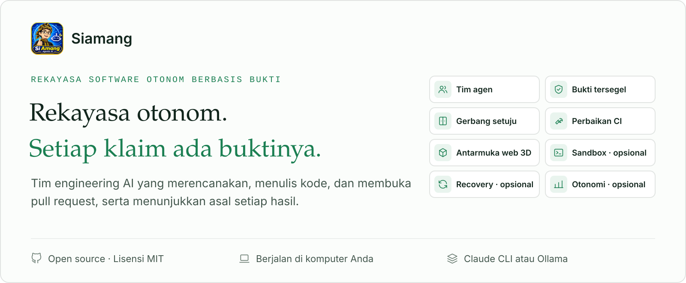
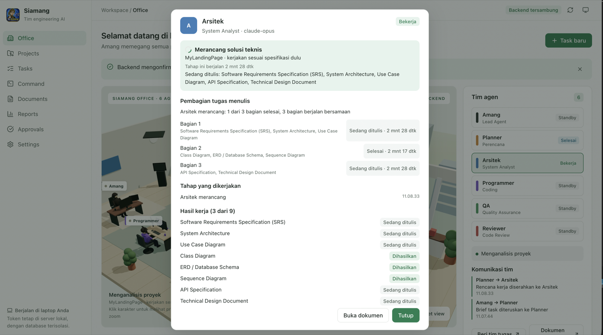
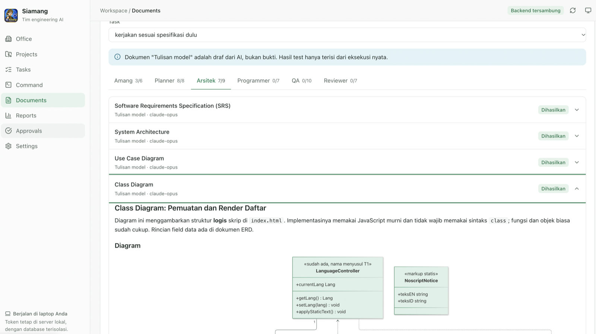
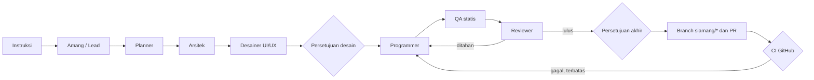
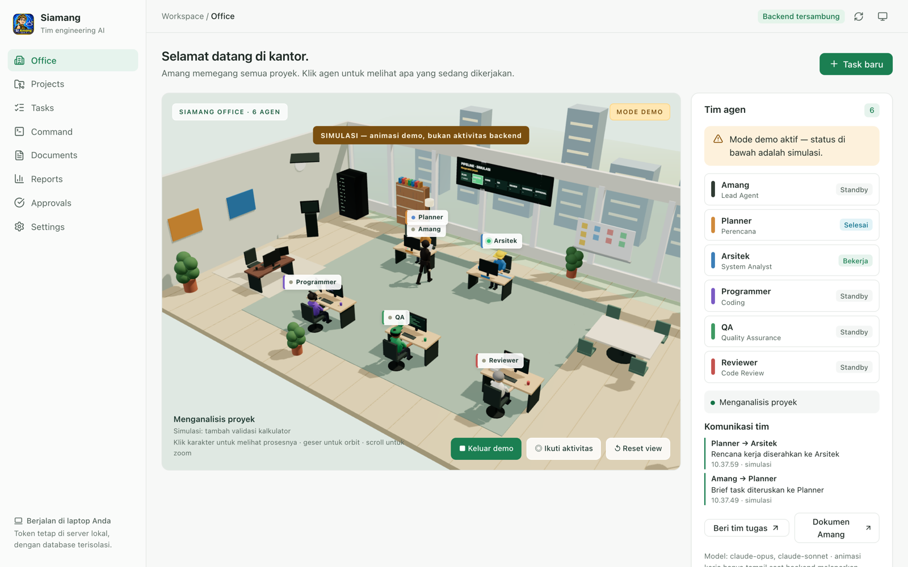

<p align="center">
  <picture>
    <source media="(prefers-color-scheme: dark)" srcset="./docs/images/readme/hero-id-dark.svg">
    
  </picture>
</p>

<p align="center">
  <a href="./docs/README.md"></a>
  <a href="./CHANGELOG.md"></a>
  <a href="./LICENSE"></a>
  <a href="./pyproject.toml"></a>
  <a href="https://github.com/Rafie93/siamang-ai/stargazers"></a>
  <br/>
  <a href="https://github.com/Rafie93/siamang-ai/actions/workflows/ci.yml"></a>
  <a href="#antarmuka-web"></a>
  <a href="https://code.claude.com/docs"></a>
  <a href="https://ollama.com/"></a>
</p>

<p align="center">
  <a href="./README.md">English</a> · <b>Bahasa Indonesia</b>
</p>

<p align="center">
  <a href="#ringkasan">Ringkasan</a> ·
  <a href="#demo">Demo</a> ·
  <a href="#mulai-cepat">Mulai Cepat</a> ·
  <a href="#antarmuka-web">Antarmuka Web</a> ·
  <a href="#cli">CLI</a> ·
  <a href="#http-api">HTTP API</a> ·
  <a href="#yang-baru">Yang Baru</a> ·
  <a href="#fitur">Fitur</a> ·
  <a href="#dokumentasi">Dokumentasi</a> ·
  <a href="#pengembangan">Pengembangan</a>
</p>

## Ringkasan

Siamang adalah tim engineering AI yang menerima tugas pengembangan software, merencanakannya, menulis kode untuk repo nyata, memeriksanya, lalu membuka pull request setelah Anda setuju. Anda tidak diminta percaya pada jawaban agen, karena setiap hasil menunjukkan dari mana asalnya.

Siamang berdiri sendiri: tanpa control plane eksternal, dan intinya tanpa dependency Python di luar standard library.

> [!IMPORTANT]
> **v0.3.0 masih tahap awal.** Siamang berjalan lokal untuk satu operator dan belum siap dipasang di internet. Otonomi penuh masih dalam pengerjaan. Pada konfigurasi bawaan, dua gerbang wajib disetujui manusia dan Siamang tidak menjalankan kode proyek, sehingga hasil test hanya berasal dari CI GitHub. Lihat [Fitur](#fitur).

## Demo

Screenshot berikut berasal dari run sungguhan: satu task pada proyek landing page kecil, dengan model `claude-opus`.

### Cara kerja: tim membagi pekerjaan

<a href="./docs/images/readme/cara-kerja-membagi-part.png">
  
</a>

Daripada satu panggilan model yang panjang, dokumen desain Arsitek dibagi menjadi beberapa bagian yang berjalan bersamaan. Klik agen mana pun untuk melihat apa yang sedang dikerjakannya: dokumen yang ditulis tiap bagian, lama berjalannya, dan yang sudah selesai. Kalimat "3 bagian berjalan bersamaan" dihitung dari jam yang dicatat backend, bukan diasumsikan.

### Hasil: dokumen yang bisa Anda baca

<a href="./docs/images/readme/bukti-nyata-kerja.png">
  
</a>

Hasil kerja tiap agen punya tab sendiri, dan diagram langsung tergambar di halaman. Setiap dokumen menyatakan asalnya: di sini, *Tulisan model · claude-opus* berarti ditulis oleh model. Dokumen seperti ini adalah draf, bukan bukti, dan halamannya menyatakan hal itu. Programmer, QA, dan Reviewer masih 0 karena coding baru dimulai setelah Anda menyetujui desain.

## Mengapa Siamang

Agen coding sering melaporkan "semua test lulus". Di Siamang, model tidak bisa membuat klaim itu.

| Prinsip | Hari ini | Direncanakan |
|---|---|---|
| **Asal setiap hasil terlihat** | Dokumen berlabel `authored` (tulisan model), `derived` (dihitung sistem), atau `measured` (hasil ukur) | Berlaku juga untuk tiap aksi agen |
| **Model tidak bisa mengaku lulus** | Status lulus berasal dari pemeriksaan deterministik, dan hasil test dari CI, atau dari sandbox bila dinyalakan | Setiap acceptance criteria dicocokkan dengan sebuah check |
| **Keputusan terikat pada bukti** | Persetujuan menghitung ulang rantai bukti dan menolak yang berubah | Keputusan otomatis dicatat dengan cara yang sama |
| **Gagal berarti diperbaiki, dengan batas** | Tahap desain yang gagal diulang tiga putaran, paket yang timeout dibelah dua, CI yang gagal kembali ke Programmer; semuanya berbatas dan tercatat | Perencanaan ulang yang benar-benar mengubah langkah |
| **Otonomi bisa diaudit** | Pada konfigurasi bawaan dua gerbang wajib disetujui manusia; gerbang berbasis risiko bisa dinyalakan, dan keputusannya tercatat atas nama kebijakan | Level per proyek |

### Cara satu task berjalan



## Mulai Cepat

**Yang dibutuhkan:** macOS atau Linux, Python 3.11+, dan Git 2.36+. Antarmuka web juga butuh Node.js 20.19+. Untuk bekerja di repo GitHub, login dengan [`gh`](https://cli.github.com/) memakai akun yang bisa menulis ke repo itu.

### 1. Pasang

```bash
git clone https://github.com/Rafie93/siamang-ai.git
cd siamang-ai
python3 -m venv .venv
source .venv/bin/activate
pip install -e '.[api]'
```

### 2. Pilih model

Salin salah satu template ke `siamang.toml`, yang tidak ikut masuk Git:

| Model | Perintah | Sebelum mulai |
|---|---|---|
| Claude | `cp siamang.claude.example.toml siamang.toml` | Login dengan CLI [`claude`](https://code.claude.com/docs). Untuk pemakaian pribadi. |
| Ollama | `cp siamang.ollama.example.toml siamang.toml` | Jalankan [Ollama](https://ollama.com/), lalu isi `provider_model` dengan tag dari `ollama list`. |

Lalu periksa:

```bash
export SIAMANG_CONFIG="$PWD/siamang.toml"
siamang health            # konfigurasi, penyimpanan, dan database
siamang models --check    # keluar dengan error bila provider model belum siap
```

### 3. Pilih cara kerja

| Cara | Cocok untuk | Menjalankan agen? |
|---|---|---|
| [Antarmuka web](#antarmuka-web) | Pemakaian sehari-hari: mulai dari sini | Ya |
| [HTTP API](#http-api) | Skrip dan integrasi | Ya |
| [CLI](#cli) | Memeriksa dan mengelola data yang tersimpan | Tidak |

## Antarmuka Web

```bash
cd web
npm install
npm run dev               # http://127.0.0.1:5180
```

Satu perintah ini sekaligus menjalankan backend, jadi server API tidak perlu dijalankan sendiri. Hentikan semuanya dengan `Ctrl+C`. Untuk build produksi, jalankan `npm run build && npm start`.

<a href="./docs/images/readme/office-light.png">
<picture>
  <source media="(prefers-color-scheme: dark)" srcset="./docs/images/readme/office-dark.png">
  
</picture>
</a>

<p align="center"><sub>Mode demo, yang selalu diberi label simulasi.</sub></p>

### Task pertama Anda

1. Pastikan bilah atas menampilkan **Backend tersambung**.
2. Buka **Projects**, pilih **Proyek baru**, tempel URL GitHub seperti `https://github.com/OWNER/REPO`, lalu pilih **Buat proyek**.
3. Amang membaca repo dan bertanya. Jawab di halaman proyek, lalu pilih **Setujui spesifikasi**.
4. Buka **Command**, tulis yang Anda inginkan, lalu pilih **Kirim ke Amang**. Periksa ringkasannya, lalu pilih **Setuju, buat task dan mulai**.
5. Ikuti pekerjaannya di **Office** atau **Tasks**. Saat desain siap, baca di **Artifacts**, lalu pilih **Setujui desain** pada task.
6. Saat hasil siap, baca buktinya di **Reports**, lalu pilih **Approve** di **Approvals**. Siamang membuat commit di branch `siamang/*` dan membuka pull request. Merge tetap di tangan Anda.

Untuk melihat-lihat tanpa model atau repo, pilih **▶ Mode demo** di halaman **Office**. Untuk mengganti model tiap agen, buka **Settings**.

### Isinya

| Area | Fungsi |
|---|---|
| **Kantor 3D** | Tujuh agen, masing-masing dengan meja dan monitor animasi. Orbit, zoom, ikuti aktivitas, atau klik agen untuk melihat kerjanya. |
| **Serah-terima** | Setiap perubahan fase yang tercatat dimainkan sebagai serah-terima antar-agen. Agen hanya tampil bekerja bila backend melaporkan aktivitas segar, tidak pernah saat offline atau stale. |
| **Command dua arah** | Amang memastikan instruksi Anda sebelum task dibuat, dan task yang berhenti menjelaskan alasannya serta bisa dilanjutkan dengan jawaban Anda. |
| **Artifacts** | Hasil kerja tiap agen (dokumen, diagram, wireframe) beserta asalnya: tulisan model, dihitung sistem, atau hasil ukur. Ada pencarian, filter, dan daftar isi untuk dokumen panjang. |
| **Bukti dan approval** | Pemeriksaan dengan exit code, percobaan recovery, dan utang teknis saat sandbox menyala. Tanpa sandbox, halaman ini menyatakan kode belum dijalankan. |
| **Mode demo** | Simulasi untuk presentasi, selalu berlabel dan tidak masuk ke Tasks, Reports, dan Approvals. |
| **Aksesibilitas** | Daftar tim dan log berbasis teks, reduced motion, kontrol native yang ramah keyboard, dan fallback 2D tanpa WebGL. |

### Pengaturan

| Variabel | Bawaan | Fungsi |
|---|---|---|
| `PORT` | `5180` | Port antarmuka |
| `WEB_DATA` | `~/.siamang/web` | Database, kunci segel, dan clone proyeknya. Simpan di luar repo ini. |
| `SIAMANG_ROOT` | folder induk | Lokasi backend |
| `WEB_SANDBOX` | mati | `1` menambah proyek contoh, yang dibutuhkan test end-to-end |

## CLI

CLI memeriksa dan mengelola data yang disimpan Siamang. **CLI tidak menjalankan agen:** untuk memulai pekerjaan, pakai antarmuka web atau HTTP API. CLI membaca konfigurasi dari `SIAMANG_CONFIG` atau `--config`, jadi jalankan ini dulu di setiap terminal baru:

```bash
source .venv/bin/activate
export SIAMANG_CONFIG="$PWD/siamang.toml"
```

| Perintah | Fungsi |
|---|---|
| `siamang health`, `siamang version` | Memeriksa konfigurasi, penyimpanan, dan database; menampilkan versi |
| `siamang validate` | Memvalidasi konfigurasi, skema database, dan kontrak |
| `siamang models --check` | Menampilkan model dan memeriksa kesiapan providernya |
| `siamang projects` | Menampilkan proyek; tambah `--all` untuk yang diarsipkan dan `--json` untuk skrip |
| `siamang projects register --name NAMA --path PATH --type web` | Mendaftarkan repo lokal |
| `siamang projects get\|update\|archive\|restore` | Mengelola proyek |
| `siamang git inspect\|status\|diff\|worktrees PROJECT_ID` | Tampilan Git read-only dari sebuah proyek |
| `siamang tasks --project PROJECT_ID` | Menampilkan task; saring dengan `--status` |
| `siamang tasks get TASK_ID` | Membaca satu task |
| `siamang tasks cancel\|retry TASK_ID --yes` | Membatalkan task atau mengantrekan ulang; tidak ada yang dijalankan |
| `siamang tasks recovery` | Menampilkan task aktif, untuk melihat yang mungkin perlu dipulihkan |
| `siamang replay TASK_ID`, `siamang events` | Membaca event yang tersimpan |
| `siamang tools`, `siamang orchestrator`, `siamang planner`, `siamang qa`, `siamang approval`, ... | Menampilkan katalog dan kebijakan; tidak ada yang dijalankan |

Jalankan `siamang --help` untuk semuanya, atau `siamang PERINTAH --help` untuk satu perintah.

> [!NOTE]
> Antarmuka web memakai database sendiri, terpisah dari yang ada di `siamang.toml`. Untuk membaca proyek dan task-nya dari CLI, arahkan CLI ke sana. Ini tetap bisa saat antarmuka sedang berjalan:
>
> ```bash
> SIAMANG_STORAGE_PATH="$HOME/.siamang/web/office.db" siamang projects
> ```

## HTTP API

Pakai ini untuk skrip. Berbeda dari antarmuka web, server dijalankan sendiri dan butuh kredensial lokal. Server hanya bind ke `127.0.0.1`.

```bash
python3 scripts/init-credentials.py    # membuat ~/.config/siamang/local.env dan mencetak SIAMANG_TOKEN sekali: simpan
./scripts/run-local.sh --port 8765
```

Di terminal lain, jalankan baris `export SIAMANG_TOKEN=...` yang tercetak di atas, lalu:

```bash
api() { curl -s -H "Authorization: Bearer $SIAMANG_TOKEN" -H 'Content-Type: application/json' "http://127.0.0.1:8765/v0$1" "${@:2}"; }

api /capabilities    # memastikan server dan model siap
api /projects -d '{"name": "demo", "repository": "OWNER/REPO"}'    # Siamang meng-clone-nya ke direktori miliknya sendiri
```

Sebuah task lalu melewati panggilan berikut:

| # | Langkah | Panggilan API |
|---|---|---|
| 1 | Amang membaca repo dan bertanya; jawab lalu setujui spesifikasinya | `POST /projects/{id}/intake/messages`, `POST /projects/{id}/intake/approve` |
| 2 | Sampaikan pekerjaan; Amang menyusun brief, lalu Anda mengonfirmasinya | `POST /projects/{id}/drafts`, `POST /projects/{id}/drafts/{draft}/confirm` |
| 3 | Planner, Arsitek, dan Desainer menulis dokumen desain; run berhenti di gerbang pertama | `GET /tasks/{id}/documents`, `POST /tasks/{id}/design-decision` |
| 4 | Programmer, QA, dan Reviewer bekerja dalam loop terbatas; run berhenti di gerbang kedua | `GET /tasks/{id}/reports`, `GET /approvals?project_id={id}` |
| 5 | Setelah Anda setuju, Siamang menghitung ulang bukti, membuat commit dan PR | `POST /approvals/{run_id}` |
| 6 | Siamang mengikuti CI; yang gagal kembali ke Programmer, dengan batas | `GET /tasks/{id}` (`task.ci`) |

Kedua keputusan memakai body yang sama. Pada konfigurasi bawaan, merge tetap di tangan Anda.

```bash
api /tasks/TASK_ID/design-decision -d '{"decision": "approve", "reason": "Desain sesuai kebutuhan."}'
api /approvals/RUN_ID -d '{"decision": "approve", "reason": "Bukti sudah saya periksa."}'
```

Referensi lengkap ada di [docs/HTTP_API.md](docs/HTTP_API.md), dan kontrak OpenAPI ada di `GET /v0/openapi.json`.

## Yang Baru

### v0.3.0

Belum ditandai sebagai rilis GitHub. Rinciannya ada di [changelog](./CHANGELOG.md).

- **Eksekusi sandbox** (opsional): test dan build berjalan di container, dan hasilnya menentukan lulus tidaknya run. Belum diuji dengan container nyata.
- **Programmer dengan tool** (opsional): Programmer mengedit dan menjalankan perintah di sandbox sebelum mengusulkan patch.
- **Recovery Engine** (opsional): tiga tingkat pemulihan berbatas saat delivery gagal. Belum berlaku untuk run paket paralel.
- **Level otonomi dan Lead otonom** (opsional): gerbang berbasis risiko, tercatat atas nama kebijakan. Belum diuji bersama model, container, dan GitHub nyata.
- **Pembagian kerja**: dokumen desain dan paket kerja berjalan paralel dalam satu task, dengan percobaan ulang berbatas, dan catatannya menunjukkan apa yang benar-benar berjalan bersamaan.
- **Perbaikan CI otomatis**: build gagal pada pull request yang sudah disetujui dan masih terbuka kembali ke Programmer, dalam jumlah terbatas.
- **Antarmuka web dalam satu repo**: dibangun ulang tanpa template komersial, dan kini ada di `web/` dengan versi yang sama dengan backend.

## Fitur

| Kemampuan | Status | Catatan |
|---|---|---|
| Lead, Planner, Arsitek, Desainer, Programmer, QA, Reviewer | Tersedia | Alur tahap ditentukan kode |
| Branch `siamang/*`, PR, dan pembacaan CI GitHub | Tersedia | Tanpa force push; tanpa merge kecuali level otonomi 3 |
| Perbaikan otomatis saat CI gagal | Tersedia | Hanya pada PR yang sudah disetujui dan masih terbuka; `ci_repair = 0` untuk mematikan |
| Paket kerja paralel | Tersedia | Sejauh ini baru diuji dengan model tiruan |
| Test dan build di sandbox | Opsional, mati secara bawaan | Belum diuji dengan container nyata |
| Programmer yang memakai tool | Opsional, mati secara bawaan | Belum diuji dengan container nyata |
| Recovery Engine tiga tingkat | Opsional, mati secara bawaan | Belum berlaku untuk run paket paralel |
| Level otonomi dan Lead otonom | Opsional, mati secara bawaan | Belum diuji dengan model, container, dan GitHub nyata; [docs/AUTONOMY.md](docs/AUTONOMY.md) |
| Pencocokan acceptance criteria dengan check | Belum ada | Hari ini semua kriteria berstatus `not_verified` |
| Beberapa task bersamaan | Belum ada | Satu task berjalan pada satu waktu |
| Login multi-user, TLS, GitHub App | Belum ada | Jangan buka API ke internet |

**Benchmark:** belum ada hasil yang bisa diterbitkan, jadi README ini tidak memuat angka kualitas, biaya, atau waktu. Rencananya ada di [Phase 32.5](docs/PHASE_ROADMAP.md#phase-325-benchmark-kesiapan-rilis). Test di repo ini berjalan offline dengan model tiruan: test membuktikan perilaku sistem, bukan mutu kode yang ditulis model.

## Keamanan dan Batasan

- Push hanya ke branch `siamang/*`, tanpa force. Merge hanya terjadi bila operator memilih level otonomi 3.
- Pada konfigurasi bawaan, perubahan pertama selalu menunggu persetujuan Anda. Perbaikan CI otomatis hanya masuk ke PR yang sudah Anda setujui dan masih terbuka.
- Perbaikan CI ditahan bila terlihat menyembunyikan kegagalan, misalnya mengubah konfigurasi CI, menghapus test, atau menambah skip. Pemeriksaan ini heuristik, bukan bukti perbaikan yang jujur.
- Agen membaca isi repo dan mengirimkannya ke provider model yang Anda pilih.
- Siamang push ke GitHub memakai login `gh` Anda.
- Status lulus dari QA statis tidak membuktikan kode berjalan. Tinjau setiap PR sebelum merge.

Baca [SECURITY.md](SECURITY.md) sebelum menjalankan Siamang. Kerentanan dilaporkan lewat tab **Security** di repo, bukan lewat issue publik.

## Dokumentasi

Dokumen di `docs/` saat ini sebagian besar berbahasa Indonesia.

| Dokumen | Isi |
|---|---|
| [docs/README.md](docs/README.md) | Index seluruh dokumentasi |
| [docs/REFERENCE.md](docs/REFERENCE.md) | Konfigurasi, CLI, ringkasan HTTP API, tim agen, dan perilaku pada pekerjaan besar |
| [docs/VISION.md](docs/VISION.md) | Tujuan, prinsip, level otonomi, status komponen |
| [docs/PHASE_ROADMAP.md](docs/PHASE_ROADMAP.md) | Urutan pekerjaan |
| [docs/ARCHITECTURE.md](docs/ARCHITECTURE.md) | Struktur dan keputusan desain |
| [docs/HTTP_API.md](docs/HTTP_API.md) | Referensi API |
| [docs/SANDBOX.md](docs/SANDBOX.md) | Test dan build di container (opsional) |
| [docs/AUTONOMY.md](docs/AUTONOMY.md) | Level otonomi dan Lead otonom (opsional) |
| [docs/SKILL.md](docs/SKILL.md) | Panduan untuk agen AI |
| [docs/WEB.md](docs/WEB.md) | Antarmuka web: lapisan, aliran data, dan aturan adegan 3D |
| [docs/WEB_CONTRACT.md](docs/WEB_CONTRACT.md) | Kontrak HTTP yang dipakai antarmuka web |
| [THIRD_PARTY_NOTICES.md](THIRD_PARTY_NOTICES.md) | Dependency dan lisensinya (bahasa Inggris) |

## Pengembangan

```bash
pip install -e '.[dev,api]'
.venv/bin/pytest                               # test offline, tanpa LLM
.venv/bin/python scripts/smoke_http.py         # HTTP dengan server dan database sementara
cd web && npm ci && npm test                             # test unit dan komponen web
```

Lihat [CONTRIBUTING.md](./CONTRIBUTING.md). Proyek ini dirawat satu orang, jadi buka issue dulu sebelum perubahan besar.

## Lisensi

[MIT](./LICENSE)
