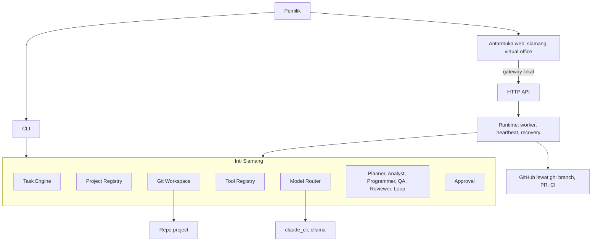

# Siamang: Architecture

Arsitektur untuk **Evidence-Based Autonomous Software Engineering**.

Dokumen ini adalah ringkasan. Detail tiap komponen ada di dokumen masing-masing
([docs/README.md](README.md)), dan arah ke depan ada di [VISION.md](VISION.md).

## 1. Prinsip

1. **Bukti mengalahkan klaim.** Status berasal dari artefak nyata. Output model
   adalah data tak tepercaya yang divalidasi sebelum dipakai.
2. **Siamang headless.** Semua fungsi tersedia lewat CLI dan HTTP. Antarmuka visual
   adalah klien terpisah.
3. **Satu titik temu: kontrak.** Klien hanya mengenal kontrak dan API, bukan
   planner, agent, model, atau database. Lihat [CONTRACT.md](CONTRACT.md).
4. **Deny by default.** Tidak ada aksi berisiko tanpa izin dan persetujuan yang
   bisa diaudit.
5. **Inti tanpa dependency.** Paket inti hanya memakai stdlib; FastAPI dan Uvicorn
   berada di belakang extra `api`.

## 2. Topologi

## 3. Alur satu task

1. **Masuk:** task dibuat lewat API atau CLI. Pengiriman tidak langsung menjalankan.
2. **Brief:** Lead bertanya bila perlu, lalu menulis brief.
3. **Desain:** Planner dan Analyst menulis dokumen. Jika salah satunya punya model,
   run berhenti di `design_approval`.
4. **Kode:** Analyst boleh membagi pekerjaan menjadi paket. Tiap paket melewati
   Loop (Programmer, QA, Reviewer) secara paralel di salinan repo sendiri, lalu
   digabung dan diperiksa sekali lagi.
5. **Persetujuan akhir:** keputusan terikat pada rantai bukti di [APPROVAL.md](APPROVAL.md).
6. **Publikasi:** satu branch `siamang/*` dan satu PR. Hasil CI GitHub dicatat
   sebagai dokumen `measured`.

Tiap agen menghasilkan dokumen berlabel `authored`, `derived`, atau `measured`.
Detailnya ada di [HTTP_API.md](HTTP_API.md).

## 4. Lapisan

| Lapisan | Modul | Tanggung jawab |
|---|---|---|
| Antarmuka | `api/`, `cli/` | Autentikasi, izin, route, command |
| Runtime | `api/runtime.py`, `api/parallel.py` | Menjadwalkan run, tahap, paket paralel, publikasi, CI |
| Kerja | `planner/`, `analyst/`, `programmer/`, `qa/`, `reviewer/`, `loop/`, `documents/` | Menghasilkan dan menilai usulan |
| Keputusan | `approval/` | Keputusan manusia atas bukti |
| Sumber daya | `models/`, `tools/`, `git/`, `repos/`, `projects/` | Akses model, tool, dan repository |
| Fondasi | `tasks/`, `storage/`, `contracts/`, `bus.py`, `config.py` | State, persistensi, kontrak, event |

Test arsitektur menegakkan arah impor antar-lapisan.

## 5. Komunikasi

* **Klien ke Siamang:** HTTP di `127.0.0.1` dengan bearer token. Status dibaca lewat
  polling; WebSocket dan SSE belum ada.
* **Di dalam Siamang:** bus internal. Event internal **tidak** bocor ke kontrak;
  hanya event kontrak yang disimpan untuk replay.

## 6. Kepemilikan

### Project

* Siamang pemilik tunggal registry project: ID stabil, path absolut, repo, status.
* Project nyata **tidak pernah** berada di dalam repo Siamang. Aturan ini dibaca per
  **repository** (Phase 08, G4): project yang repo Git-nya adalah repo terlindungi,
  atau clone/worktree-nya, ditolak oleh Git layer (`protected_repository`).
* Project didaftarkan secara eksplisit. Tidak ada impor otomatis.

### Data

Project, task, keputusan, dokumen agen, dan bukti approval disimpan di database
Siamang. Klien tidak mengaksesnya secara langsung.

### Tool

Tool engineering berada di bawah izin Siamang. Klien mengirim task, bukan memanggil
tool. Model hari ini tidak bisa memilih tool.

## 7. Siklus clone repository

Menautkan repo GitHub membuat **clone penuh yang dimiliki Siamang**, terpisah dari
folder kerja Anda.

| Hal | Perilaku |
|---|---|
| Lokasi | `<folder database>/workspaces/<project id>` |
| Salinan paket paralel | `<folder database>/packages/<run id>`, tanpa `.git`, dihapus setelah selesai |
| Saat Lead membaca repo | `fetch --prune`, lalu membaca objek Git `origin/<branch utama>`, tanpa mengubah folder kerja. Revisi dengan PR terbuka membaca branch PR itu |
| Saat task mulai | `fetch --prune`, lalu pindah ke branch task dari `origin`, `reset --hard`, dan `clean -fdx` |
| Saat publikasi | Clone disiapkan ulang dengan cara yang sama, lalu patch diterapkan, commit, dan push tanpa force |
| Isi file berubah sejak patch dibuat | Publikasi gagal dengan `patch_stale`, tidak ada yang ditimpa |
| Branch remote bergeser | Push gagal, tidak ada yang ditimpa |
| Perubahan manual di dalam clone | Terhapus pada persiapan berikutnya, jadi jangan bekerja di folder ini |

Batas yang diketahui:

* Tidak ada sinkronisasi latar, karena tidak ada yang membaca clone di antara momen di atas.
* Jika `fetch` Lead gagal, Lead memakai data terakhir dengan tanda `fetched_latest: false`.
* Spesifikasi proyek yang sudah disetujui tidak diperbarui otomatis saat repo berubah.
* Clone tidak pernah dibersihkan, karena project tidak bisa dihapus (P3).

## 8. Aturan dependensi

Test arsitektur menegakkan aturan ini:

* Inti tidak mengimpor `api`. FastAPI dan Uvicorn hanya ada di belakang extra `api`.
* `tasks` tidak mengimpor model, tool, Git, atau agen. Task Engine hanya mengelola state.
* Programmer, QA, dan Reviewer tidak saling memanggil. Hanya Loop yang merangkai mereka,
  dan hanya Approval yang memutuskan.
* Git layer berjalan lewat satu boundary dengan allowlist perintah read-only. Penulisan ke
  repo yang dikelola hanya ada di `repos/`.

## 9. Keputusan utama

ID mengikuti penomoran asli per phase.

| ID | Keputusan | Alasan |
|---|---|---|
| D1 | Inti hanya memakai stdlib | Dependency minimal dan mudah diaudit |
| D2 | Config TOML | `tomllib` ada di stdlib |
| D8 | Event append-only ditegakkan di SQLite | Riwayat tidak bisa diubah diam-diam |
| D9 | Status internal `accepted` dipetakan ke `queued`; kini digantikan K1 | Catatan riwayat kontrak |
| D12 | Skema lewat `PRAGMA user_version`; DB lebih baru dari kode ditolak | Tanpa alat migrasi |
| M6 | Model yang disebut eksplisit tidak punya fallback | Pemanggil harus tahu bila model gagal |
| M9 | Kredensial berupa nama env var, bukan nilai | Secret tidak masuk file |
| P3 | Project tidak bisa dihapus | Task dan event merujuk identitasnya |
| G2 | Satu boundary Git dengan allowlist read-only | Permukaan yang bisa diaudit |
| G3 | Env anak Git tetap, tanpa token, hook, atau config pengguna | Repo tak tepercaya tidak bisa menjalankan kode |
| G4 | Repo terlindungi dikenali per repository lewat commit penanda | Clone dan worktree ikut tertolak |
| T3 | Izin efektif adalah irisan izin context dan plafon policy; deny by default | Pemanggil tidak bisa menaikkan izin |
| T5 | Registry menolak tool yang mengubah sesuatu | Tool tulis belum punya batas pengaman |
| K1 | Status `queued`, `running`, `waiting`, `completed`, `failed`, `cancelled` | Transisi hanya lewat satu tabel |
| K2 | Setiap mutasi task adalah satu transaksi bersama event-nya | State dan event tidak bisa berselisih |
| K8 | Setelah crash, status tidak ditebak | State saja tidak tahu apa yang terjadi |
| K15 | `request_id` membuat pembuatan task idempoten | Pengiriman ulang aman |
| A11 | Agen tidak bisa memanggil agen lain | Alur tetap bisa diaudit |
| O3 | Orchestrator tanpa loop dan retry otomatis | Lihat [VISION.md](VISION.md) untuk rencana perubahan |
| SA7 | Temuan menyatakan `observed`, `inferred`, atau `unknown` | Dugaan tidak tampil sebagai fakta |
| PR5 | Output model adalah data tak tepercaya, divalidasi ketat | `{"command": ...}` hanya menjadi output yang ditolak |
| PR17 | `before_hash` hanya untuk file yang teramati | Hash tidak pernah dikarang |
| QA8 | `pass` bukan bukti kebenaran; `not_verified` menyebut yang tidak diperiksa | Tidak ada klaim tanpa dasar |
| RV7 | Hasil QA menjadi bukti: QA gagal berarti review gagal | Review tidak bisa lebih baik dari buktinya |
| LP5 | Status Loop mengikuti bukti terakhir, tidak pernah lebih baik | Mencegah kelulusan semu |
| LP10 | Bawaan 3 putaran, batas keras 5 | Loop selalu berhenti |
| AP2 | Tidak ada approval otomatis atau implisit | Lihat [VISION.md](VISION.md) untuk rencana kebijakan |
| AP6 | Provenance berupa ID dan content hash yang dihitung ulang | Rantai bukti palsu tertolak |
| AP11 | Hasil approval disegel dengan HMAC | Hasil yang dipalsukan atau dipindah tertolak |
| H2 | Heartbeat berarti hidup, bukan kemajuan | Status tetap jujur |
| H3 | Satu runtime per DB; restart menandai run terputus, tidak diulang otomatis | Tidak ada eksekusi ganda |
| H7 | Bukti tersimpan memakai codec bertipe tetap dan HMAC, bukan pickle | Data tersimpan tidak bisa menjalankan kode |
