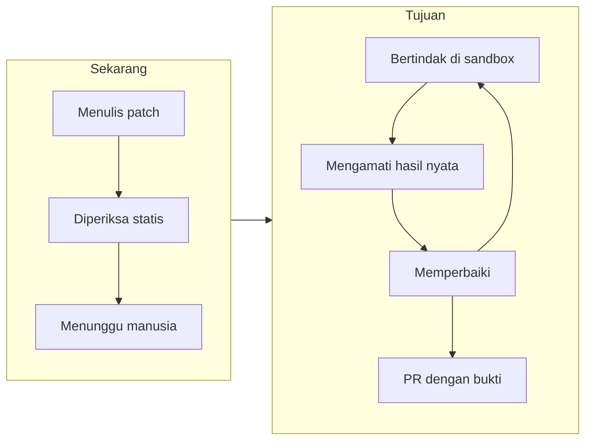

# Siamang: Evidence-Based Autonomous Software Engineering

*Autonomous engineering. Every claim backed by evidence.*

*Rekayasa software otonom. Setiap klaim ada buktinya.*

**Keputusan arah (3 November 2026):** Siamang berkembang dari *proposal pipeline*
menjadi sistem **Evidence-Based Autonomous Software Engineering**: sistem yang
menerima tujuan, lalu merencanakan, menulis kode, menjalankannya, memperbaiki
berdasarkan hasil nyata, dan menyerahkan perubahan yang disertai bukti.

Dokumen ini menjelaskan tujuan. Kondisi kode hari ini ada di dokumen tiap
komponen dan [HTTP_API.md](HTTP_API.md). Urutan kerjanya ada di
[PHASE_ROADMAP.md](PHASE_ROADMAP.md).

## Posisi produk

Inti Autonomous Software Engineering tetap sama seperti sistem sejenis: tim agen,
eksekusi terisolasi, loop perbaikan, kerja paralel, sampai PR dan CI. Pembeda Siamang
ada pada bukti:

| Pembeda | Artinya |
|---|---|
| Asal setiap klaim terlihat | Tulisan model, hitungan sistem, dan hasil eksekusi tidak pernah dicampur |
| Bukti bisa diperiksa ulang | Hasil disegel dan dihitung ulang, bukan sekadar dicatat |
| Otonomi lewat kebijakan | Aksi otomatis tercatat seperti keputusan manusia dan bisa diaudit |
| Berdiri sendiri | Berjalan tanpa control plane eksternal |
| Bisa dipantau pemilik | Dokumen per agen dan antarmuka web, tanpa harus membaca log |

### Aturan memakai slogan

Slogan menjelaskan arah dan prinsip, bukan daftar fitur yang sudah selesai. Setiap
materi publik wajib menyebut batas hari ini, sampai phase terkait selesai:

* Jangan menyebut kode sudah dijalankan atau diuji oleh Siamang sebelum Phase 26.
  Hari ini, pada konfigurasi bawaan, bukti eksekusi hanya berasal dari CI GitHub.
  Sandbox sudah ada sebagai opsi, tetapi belum diuji dengan container nyata.
* Jangan menyebut Siamang otonom penuh. Pada konfigurasi bawaan, dua gerbang masih wajib
  disetujui manusia, dan otomatis hanya perbaikan CI pada PR yang sudah disetujui. Level
  otonomi sudah ada sebagai opsi ([AUTONOMY.md](AUTONOMY.md)), tetapi belum diuji dengan
  model, container, dan GitHub nyata.

## Dari pipeline ke runtime

## Prinsip

Prinsip ini menggantikan aturan lama yang melarang eksekusi dan loop otonom,
tetapi aturan lama tetap berlaku di kode sampai phase penggantinya selesai.

1. **Bukti mengalahkan klaim.** Status "lulus" hanya boleh berasal dari eksekusi
   nyata. Tulisan model tetap berlabel draf, seperti pembagian
   `authored`/`derived`/`measured` hari ini.
2. **Eksekusi hanya di sandbox.** Kode proyek dan perintah agen tidak pernah
   berjalan di host, dan tidak pernah melihat secret operator.
3. **Semua aksi lewat Permission Manager.** Otonomi adalah kebijakan yang bisa
   diaudit, bukan jalan pintas di sekitar izin.
4. **Selalu terbatas.** Setiap loop punya batas putaran, waktu, dan biaya, dan
   berhenti dengan jujur saat batasnya tercapai.
5. **Kegagalan mengubah strategi.** Percobaan ulang harus membawa pendekatan baru,
   bukan mengulang hal yang sama. Test tidak boleh dibungkam agar terlihat lulus.
6. **Kompromi harus terlihat.** Cakupan yang dikurangi dicatat sebagai utang teknis
   dan tampil di PR.
7. **Manusia memegang keputusan yang sulit dibatalkan.** Merge dan deploy tetap di
   tangan manusia kecuali kebijakan yang lebih longgar dipilih secara sadar.

## Level otonomi

| Level | Disetujui otomatis | Tetap menunggu manusia |
|---|---|---|
| 0 (bawaan) | Tidak ada | Desain dan hasil akhir |
| 1 | Desain berisiko rendah | Hasil akhir dan merge |
| 2 (target awal yang diusulkan) | Desain dan pembukaan PR, jika test lulus | Merge |
| 3 | Merge berisiko rendah, jika CI lulus | Perubahan berisiko tinggi dan deploy |

Perubahan yang menyentuh autentikasi, skema database, atau keamanan selalu
diperlakukan sebagai berisiko tinggi. Level bawaan untuk rilis publik adalah yang
tidak melakukan merge sendiri.

## Peta komponen

Status per 4 November 2026, berdasarkan pembacaan kode dan dokumentasi.

| Komponen | Status | Kondisi sekarang | Yang kurang | Phase |
|---|---|---|---|---|
| Amang (Lead/Orchestrator) | Sebagian | Bertanya, menyusun brief, dan melapor; bila dinyalakan, menjawab dengan kutipan dari keputusan pemilik dan mengembalikan pekerjaan yang ditahan ([AUTONOMY.md](AUTONOMY.md)) | Diuji dengan model nyata; alur tahap masih ditentukan kode | 30 |
| Planner | Sudah | PRD, roadmap, WBS, dan rencana | Perencanaan ulang saat berjalan | 28 |
| Architect | Sudah | SRS, arsitektur, diagram, `work_packages` per gelombang dengan kontrak bersama; dokumen ditulis per bagian secara paralel | Graf dependensi antar-paket; dokumen satu tahap belum saling membaca | 28, 32 |
| Programmer | Sudah | Patch, paralel per paket dalam satu gelombang; paket yang timeout dicoba lagi lalu dibelah dua; bisa memakai tool di sandbox bila dinyalakan | Pembelahan menurut isi kode, bukan hanya path | 27 |
| QA | Sebagian | Pemeriksaan statis, rencana test | Menjalankan test | 26 |
| Reviewer | Sudah | Pemeriksaan deterministik dan independen; ulasan model bersifat saran | Temuan model masuk loop revisi | 26 |
| Tool Executor | Sebagian | Registry dan izin, tool read-only; Programmer membaca, mengedit, dan menjalankan perintah di sandbox dalam batas giliran (`sandbox.tools`, [SANDBOX.md](SANDBOX.md)) | Diuji dengan container nyata; belum dipakai agen selain Programmer | 27 |
| Repository Manager | Sudah | Clone, branch, commit, PR ke `siamang/*`, baca CI | Akun per instalasi | 33 |
| Context Manager | Sebagian | Pemilihan file dan anggaran konteks | Indeks kode dan memori antar-run | 31 |
| Artifact Manager | Sebagian | Dokumen dan patch tersimpan dengan hash; tiap panggilan model desain tercatat dengan waktunya (`design_parts`) | Penyimpanan hasil build | 31 |
| Execution Sandbox | Sebagian | Container podman/docker per perintah: tanpa jaringan, tanpa secret, batas waktu dan sumber daya ([SANDBOX.md](SANDBOX.md)) | Diuji dengan container nyata | 25 |
| Verification Engine | Sebagian | QA statis, Reviewer, loop, bukti persetujuan, hasil CI GitHub, test/build di sandbox yang menentukan lulus | Pencocokan tiap acceptance criteria dengan sebuah check | 26 |
| Recovery Engine | Sebagian | Tiga tingkat (ulang dengan umpan balik, penasihat, susun ulang rencana), checkpoint penyelesaian delivery, kompromi masuk utang teknis di PR (`[recovery]`); run terputus, paket perbaikan, CI gagal kembali ke Programmer; tahap desain mengulang hanya bagian yang gagal, dan retry memakai ulang dokumen yang sudah jadi | Rollback; percobaan ulang desain baru menambah waktu, belum mengganti pendekatan; tiga tingkat belum berlaku untuk run paket paralel | 28 |
| Permission Manager | Sudah | Deny by default, izin per identitas, persetujuan dengan bukti asal-usul, gerbang berbasis risiko bila dinyalakan | Level per proyek, login multi-user | 33 |

## Aturan lama yang akan berubah

| Aturan hari ini | Sumber | Berubah di |
|---|---|---|
| QA tidak pernah menjalankan kode | [QA.md](QA.md) §11 | Phase 26, hanya di sandbox |
| Siamang tidak menjalankan kode proyek | [HTTP_API.md](HTTP_API.md) | Phase 25 |
| Model tidak bisa memilih tool | [TOOL_REGISTRY.md](TOOL_REGISTRY.md), [MODEL_LAYER.md](MODEL_LAYER.md) | Phase 27 |
| Tidak ada loop otonom | [ORCHESTRATOR.md](ORCHESTRATOR.md) | Phase 28 dan 30 |
| Satu task pada satu waktu | [HTTP_API.md](HTTP_API.md) | Phase 32 |

Dokumen komponen baru diubah saat kode berubah, supaya dokumen selalu menjelaskan
perilaku yang sebenarnya.
